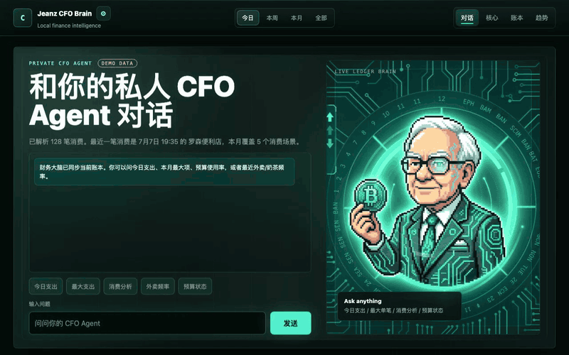
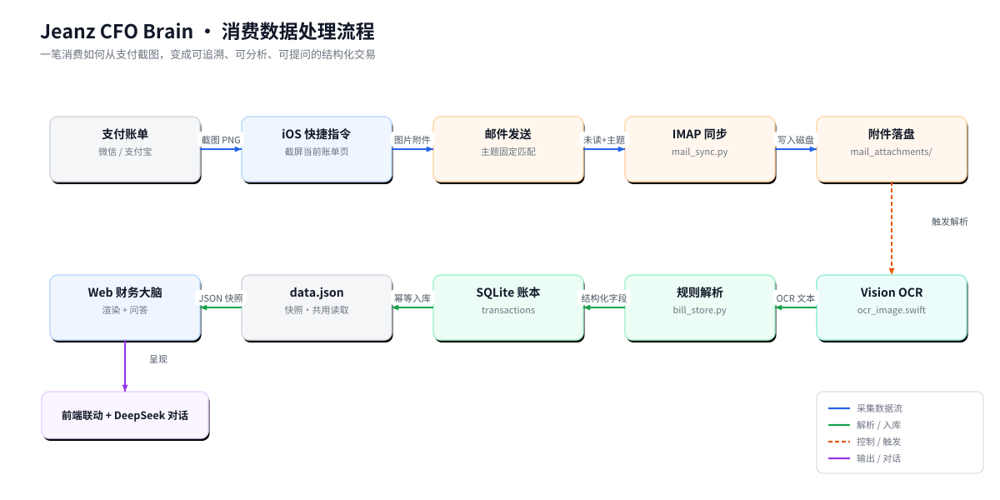
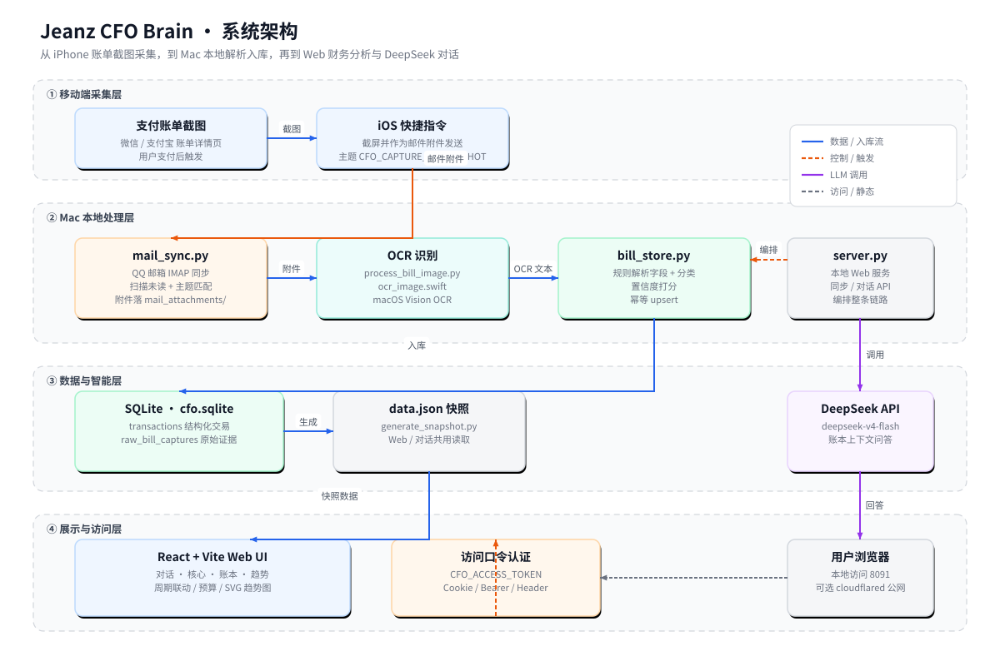
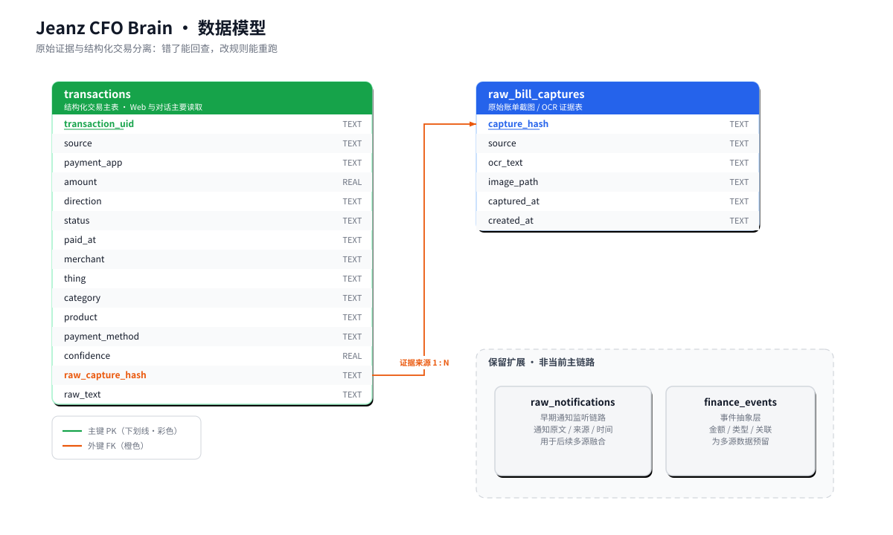
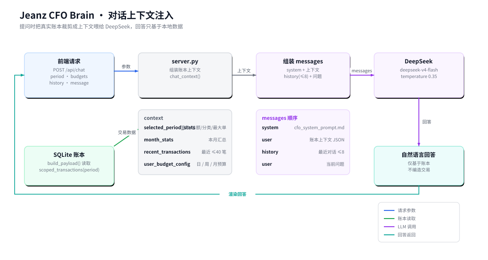

<div align="center">

[中文](README.md) · **English**


# Jeanz CFO Brain

**One tap after paying — your bills become a personal cash-flow system you can analyze and talk to.**

A self-hosted, multi-user personal CFO agent:<br>
an iPhone Shortcut uploads the bill screenshot straight to the server → OCR & rule-based parsing → one SQLite ledger per user → web finance dashboard + LLM chat.<br>
One app, one domain, sign up and go. Run it on your own Mac (OCR stays fully offline), or deploy it to a server for 24/7 operation.

[](#-quick-start)
[](#-quick-start)
[](cfo_agent_poc/web_app)
[](#-design-highlights)
[](#-design-highlights)
[](LICENSE)

[Why](#-why-this-exists) · [How it works](#-the-journey-of-one-payment) · [Quick start](#-quick-start) · [Architecture](#%EF%B8%8F-architecture) · [Design highlights](#-design-highlights) · [Roadmap](#%EF%B8%8F-roadmap)



</div>

---

## 💡 Why this exists

The fundamental problem with expense-tracking apps is that **they need you to serve them**: open the app, pick a category, type the amount, add a note… The maintenance cost is so high that most people quit within three months — and once the data stream breaks, analysis is meaningless.

What we actually care about is rarely "how much did I spend today". It's questions that require **continuous observation**:

> - Which spending scenarios have been growing lately?
> - Are habits like food delivery, coffee, or parking quietly changing?
> - Did that big purchase squeeze my daily budget?
> - Is this month's budget pace still healthy?
> - Can I just *ask* my ledger instead of scrolling through statements?

So this project doesn't try to be another expense tracker you have to babysit. It automates **everything after a payment happens** — capture, structuring, categorization, analysis, Q&A. You tap one iPhone Shortcut after paying; machines do the rest.

```
The only thing you do:  pay → tap the Shortcut.
The system does:        receive screenshot → OCR → parse → categorize → store → analyze → answer your questions anytime.
```

## ✨ Features

| | Feature | Description |
|---|---|---|
| 📸 | **Near-zero-effort capture** | Tap an iPhone Shortcut after paying: the screenshot goes straight to your ledger over HTTPS and a notification tells you what was booked. No mailbox setup. |
| 👥 | **Multi-user, one deployment** | Sign-up and login, invite codes, a separate ledger per user — one process, one port, one domain for everyone. |
| 🔍 | **Pluggable OCR** | macOS Vision by default — free, offline, screenshots never leave your machine. Switches to Alibaba Cloud OCR when deployed on Linux. |
| 🧾 | **Rule-based parsing** | Extracts amount, time, merchant, product, payment method, order ID, and infers a spending category. |
| 🧠 | **Finance dashboard** | Today / week / month / all periods in sync: total spend, category weights, cash-flow trends, budget progress. |
| 💬 | **A ledger you can talk to** | Powered by DeepSeek. Ask "what was my biggest expense this month?" — answers are grounded in your real ledger. |
| 🔗 | **Traceable evidence** | Every transaction keeps its original screenshot path and full OCR text. Bad parse? Trace back, fix the rule, re-run. |
| ♻️ | **Idempotent dedup** | A unique ID from the order number / content hash means uploading the same screenshot twice never double-books. |
| 🔐 | **You own the data** | Each account gets its own ledger directory (SQLite + screenshots), physically separated; the phone's upload key is write-only, so a leaked key reveals nothing. |

## 🎬 The journey of one payment

Follow a single transaction and you understand the whole system:

<div align="center">

</div>

1. **Pay**, then open the bill detail page in WeChat / Alipay;
2. **Trigger the "记一笔" Shortcut** — it screenshots the page and POSTs it to `/api/v1/captures` with your upload key;
3. The server stores the screenshot in **your ledger directory** under its content hash and queues a recognition job (re-uploading the same image is a no-op);
4. **OCR** reads the screenshot (system Vision on macOS, Alibaba Cloud on Linux); the raw text is archived under `data/ocr_texts/`;
5. **Rule-based parsing** extracts amount / time / merchant, builds a unique transaction ID, and **upserts into SQLite**; within seconds the result goes back to the phone as a notification like "已记账 ¥32.50 · 美团外卖";
6. Local rules and merchant memory categorize first; unfamiliar spending is completed in the background by DeepSeek using trimmed fields;
7. The dashboard refreshes stats, ledger, trends, and budget progress;
8. When you ask a question, the server injects a **trimmed ledger context** into DeepSeek and returns an answer grounded in real data.

## 🚀 Quick start

### ⚡ Try it in 30 seconds (demo mode, zero config)

No sign-up, no API key, no Shortcut — a built-in fictional ledger shows you the whole product first:

```bash
git clone https://github.com/jeanzxiang-xjz/my-cfo-agent.git
cd my-cfo-agent
./cfo_agent_poc/start_cfo_web.sh --demo
```

Open [http://localhost:8091](http://localhost:8091): no login needed, 128 fictional transactions power the full dashboard, and the chat box answers questions (via built-in analysis when no LLM key is configured). Decide later whether to hook up your real bills.

### Requirements (only needed for real bills)

> Just browsing? Demo mode above only needs Python 3 + Node.js — no API key.

- **macOS**, or a **Linux server** (see "Deploying to a Linux server" below)
- Python 3.10+
- Node.js / npm (to build the frontend)
- A [DeepSeek API key](https://platform.deepseek.com/) (chat and low-confidence categorization)

### 1. Clone & configure

```bash
git clone https://github.com/jeanzxiang-xjz/my-cfo-agent.git
cd my-cfo-agent
cp cfo_agent_poc/.env.example cfo_agent_poc/.env
```

Edit `cfo_agent_poc/.env`:

```bash
CFO_WEB_HOST=127.0.0.1
CFO_WEB_PORT=8091

# Platform data dir: accounts DB platform.sqlite plus one ledger per user under tenants/<id>/.
# Empty means cfo_agent_poc/data
CFO_HOME=

# Public URL, shown to users as the Shortcut's upload address. Leave empty for local use
CFO_PUBLIC_BASE_URL=

# DeepSeek
DEEPSEEK_API_KEY=your-deepseek-key
DEEPSEEK_BASE_URL=https://api.deepseek.com
DEEPSEEK_MODEL=deepseek-v4-flash
```

> ⚠️ The real `.env` is excluded by `.gitignore` — never commit or publish it.

### 2. Launch and sign up

```bash
./cfo_agent_poc/start_cfo_web.sh
```

The script loads `.env`, builds the frontend if needed, and starts the server. Open [http://localhost:8091](http://localhost:8091):

- **The first person to sign up becomes the admin** — no invite code needed;
- everyone after that needs an invite code: the admin generates one under "账户" (Account) in the top-right corner, or runs `python3 cfo_agent_poc/accounts.py invite` on the server.

### 3. Connect your iPhone

1. In the web app, click **"记一笔" (Add a bill) → "生成上传密钥" (Generate upload key)** and copy the key;
2. Install the "记一笔" Shortcut: if the admin configured `CFO_SHORTCUT_URL`, the dialog shows a one-tap install button that asks you to paste the key; otherwise build it yourself with the [step-by-step guide](cfo_agent_poc/docs/shortcut-setup.md) — it's just "Take Screenshot → Get Contents of URL → Show Notification".

**Daily use**: pay → open the bill detail page (make sure amount / time / item / payment method are visible) → trigger the Shortcut and wait for the "已记账" notification. Binding it to Back Tap (double-tap) works best.

> To reach the app from outside your LAN, deploy it to a server behind an HTTPS domain — see "Deploying to a Linux server" below.

### Daily usage

| Action | Effect |
|---|---|
| Tap "记一笔" on the iPhone | The screenshot is uploaded and booked; a notification shows the result within seconds |
| "记一笔" in the web app | Connect the iPhone (generate / revoke the upload key), see recent uploads, bulk-upload screenshots from a computer |
| Switch period at the top | Today / week / month / all refresh together |
| "Core" section | Period total, largest expense, category weights and behavior analysis |
| "Ledger" section | Transaction list with category filters and pagination |
| "Trend" dialog | Day / week / month cash-flow chart and budget usage |
| Gear button | Configure day / week / month budgets (stored with your account, follows you across devices) |
| "Account" button | Change display name or password, log out; admins generate invite codes here |
| Chat box | "How much did I spend today?" "Am I ordering too much delivery lately?" |

<details>
<summary><b>More commands (accounts / migrating old instances / manual processing / backup)</b></summary>

```bash
# Accounts
python3 cfo_agent_poc/accounts.py invite                 # one-time invite code, valid 14 days
python3 cfo_agent_poc/accounts.py users                  # list accounts
python3 cfo_agent_poc/accounts.py reset-password EMAIL   # new password, logs the user out everywhere

# Fold an old single-user instance into a new account (reads the old dir only, leaves every
# transaction row untouched, and checks transaction count and total afterwards)
python3 cfo_agent_poc/migrate_instance.py --src /path/to/old/cfo_agent_poc --email user@example.com

# Process one bill screenshot into a given ledger without the Shortcut
cd cfo_agent_poc
python3 process_bill_image.py /path/to/bill.png --source manual --ledger-dir data/tenants/<user-id>

# Back up the platform DB and every ledger (into <CFO_HOME>/backups/)
./cfo_agent_poc/backup_cfo_db.sh

# Health check
curl http://127.0.0.1:8091/health
```

</details>

<details>
<summary><b>Deploying to a Linux server (HTTPS domain + Alibaba Cloud OCR)</b></summary>

There's no Apple Vision outside macOS, so OCR needs another backend. `CFO_OCR_PROVIDER` defaults to `auto`:
Vision on macOS, Alibaba Cloud general OCR elsewhere; you can also set `vision` / `aliyun` explicitly.

```bash
# Dependencies are only needed for Alibaba Cloud; everything else is still pure stdlib
python3 -m venv .venv && . .venv/bin/activate
pip install -r cfo_agent_poc/requirements.txt
```

Add to `cfo_agent_poc/.env` (use a **RAM sub-user with OCR-only permissions**, never your root AccessKey):

```
CFO_OCR_PROVIDER=aliyun
ALIBABA_CLOUD_ACCESS_KEY_ID=...
ALIBABA_CLOUD_ACCESS_KEY_SECRET=...
CFO_OCR_REGION=cn-hangzhou
CFO_PUBLIC_BASE_URL=https://cfo.example.com
```

The app only listens on `127.0.0.1:8091`; a reverse proxy serves the HTTPS domain. Ready-made configs live in `cfo_agent_poc/deploy/`:

| File | Purpose |
|---|---|
| `Caddyfile` | Recommended. Caddy obtains and renews certificates automatically |
| `nginx.conf.example` | If you already run Nginx. **It must forward the `Host` header**, or saves and uploads in the web app are rejected as cross-site requests |
| `cfo-web.service` | systemd unit: start on boot, restart on failure |

Alibaba Cloud OCR doesn't support HEIC/HEIF; iPhone screenshots are PNG, so this normally never comes up.

> The frontend build `dist/` isn't in the repo. Build it on your dev machine with
> `npm run build` and upload it, so the server needs no Node toolchain.

</details>

## 🏗️ Architecture

<div align="center">

</div>

| Layer | Responsibility | Main components |
|---|---|---|
| ① Mobile capture | Screenshot the bill page and upload it over HTTPS | iOS Shortcut "记一笔" |
| ② Edge | One domain, HTTPS, upload size limit | Caddy / Nginx reverse proxy |
| ③ Server-side processing | Accounts & sessions, per-request ledger binding, capture queue, OCR, parse & store | `accounts.py` · `tenancy.py` · `capture_queue.py` · `ocr_providers.py` · `bill_store.py` · `server.py` |
| ④ Data & intelligence | Accounts DB, one ledger per user (evidence + structured transactions), LLM chat | `platform.sqlite` · `tenants/<id>/data/cfo.sqlite` · DeepSeek |
| ⑤ Presentation | Finance dashboard, account settings, iPhone connection | React 19 + Vite |

**Deliberate trade-offs:**

- **Capture via "Shortcut + direct HTTPS upload" instead of a mobile app or email** — Shortcuts cost nothing to install; uploading directly removes the whole "email it → server pulls IMAP" setup and lets the result pop straight back onto the phone. The phone only holds a **write-only** upload key, so losing it exposes nothing.
- **"One database per user" instead of one big table with a `user_id` column** — every user gets a ledger directory laid out exactly like the single-user version: existing SQL is untouched, isolation is physical, and export, deletion, backup and migration are all just directory operations.
- **Pluggable OCR instead of a hard dependency on one vendor** (`ocr_providers.py`) — macOS uses system Vision by default: local, free, great at Chinese bills, screenshots never leave the machine. But Vision is Apple-only, so running 24/7 means a Linux server, where it switches to Alibaba Cloud OCR. The seam is a single `ocr_image(path) -> str`; everything downstream is unaware of which backend ran.
- **Rule-based parsing instead of letting an LLM write to the DB** — bill layouts are stable; rules are controllable, explainable, and cost zero tokens. The LLM only handles the conversation layer.
- **Python stdlib + SQLite backend** — no heavy framework needed; one file per ledger is easy to back up and query with plain SQL. Each request authenticates first, then binds "the current ledger" to itself; an unbound request fails instead of falling back to some default database.

## 🧩 Design highlights

### Raw evidence separated from structured results

<div align="center">

</div>

`transactions` holds structured records (the UI and chat read from it); `raw_bill_captures` holds original screenshots and full OCR text. Each transaction points back to its evidence via `raw_capture_hash` — **a bad parse can always be traced to the original screenshot**, rules can be fixed and re-run, and display fields (`merchant`/`thing`) can be corrected without touching the evidence.

### Idempotent dedup

Every transaction gets a `transaction_uid`: the order number from the bill when available, otherwise a hash of "source + amount + time + product + payment method". Writes are upserts keyed on this ID — **uploading the same screenshot twice, or booking the same payment from a different screenshot, never books twice**.

### Confidence scoring

Every parse carries a confidence score, accumulated per extracted field (amount, time, status, merchant, category…). Low-confidence transactions prompt you to check the original screenshot instead of silently swallowing suspicious data.

### Trimmed context injection

<div align="center">

</div>

The server never dumps the whole database into the LLM. It builds a trimmed context — current-period stats, monthly summary, recent transactions (max 40), your budget config. The system prompt is explicit: **answer only from the provided context, admit when data is insufficient, never invent transactions.**

## 🔐 Security & privacy

- **Every account's ledger is stored separately and invisible to others**: ledger, screenshots and OCR text live under `tenants/<user-id>/`; a request can only read the logged-in user's directory, and screenshots anywhere else are never served.
- **Accounts**: passwords are stored as salted scrypt hashes; the login cookie is a random string and only its hash is stored; repeated wrong passwords are throttled; write requests are checked for a same-site origin.
- **The upload key is write-only**: the Shortcut's key can only push screenshots into your ledger — using it on any read endpoint counts as logged out. Revoke or rotate it from the web app anytime; only its hash is stored.
- DeepSeek only receives the **trimmed** ledger context when you chat; background categorization sends only merchant, product, platform and payment app — never screenshots, full OCR text, amounts, card numbers or order IDs.
- `.env` (API keys) and `data/` (accounts DB, ledgers, screenshots, OCR text) are excluded via `.gitignore`.

> Known boundaries:
> - The chat path sends partial transaction context to DeepSeek. For full offline operation, swap in a local LLM (see Roadmap).
> - **With `CFO_OCR_PROVIDER=aliyun`, bill screenshots are uploaded to Alibaba Cloud OCR** — the price of 24/7 operation on Linux. Stay on macOS with Vision and screenshots never leave your machine.
> - On a public server, every user's ledger and the platform's API keys live on that machine, and whoever operates it can see all the data. Always use HTTPS and guard access to the server.

## 🗺️ Roadmap

- [x] Multi-user: sign-up and login, invite codes, one ledger per user, direct HTTPS upload from the Shortcut
- [ ] Per-user quotas (uploads, OCR, chat tokens) and open registration
- [ ] Edit `merchant` / `thing` / `category` directly in the web UI
- [ ] LLM-assisted categorization (with rule fallback and manual confirmation)
- [ ] Daily Morning Brief: yesterday's spend, budget pace, anomaly alerts
- [ ] More capture sources: bank SMS, Apple Wallet, credit-card statement emails
- [ ] Local LLM support for fully offline operation
- [ ] Data export: CSV / monthly Markdown reports
- [ ] Per-scenario budgets: dining, entertainment, big-ticket items

## 📚 More docs

- [CFO agent system prompt](cfo_agent_poc/prompts/cfo_system_prompt.md)
- [iPhone Shortcut setup guide](cfo_agent_poc/docs/shortcut-setup.md)

## 🤝 Contributing

This project grew out of a real personal need. Issues, PRs, and ideas are all welcome — especially new bill-parsing rules, new capture sources, and local-LLM integrations.

## 📄 License

[MIT](LICENSE)

---

<div align="center">

**If this project inspired you, a ⭐️ means a lot.**

*Let the ledger speak for itself, instead of you serving the ledger.*

</div>
